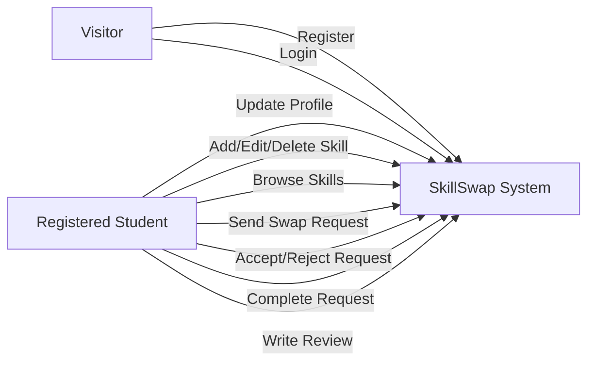
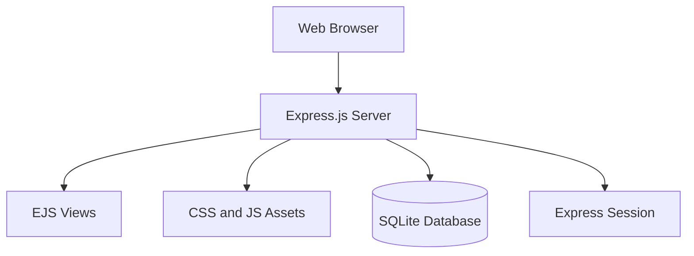
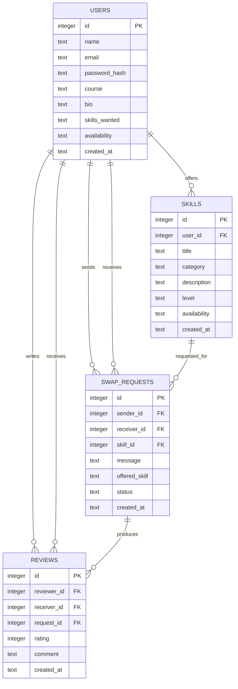

# Architecture Documentation

## System Overview

SkillSwap is a monolithic full-stack web application. It uses Express.js for backend routing, EJS for server-side rendering, SQLite for persistent storage, and session-based authentication for user login management.

The application follows a simple Model-View-Controller-inspired structure:

- Model/Data Layer: SQLite database and SQL queries
- View Layer: EJS templates in the `views` folder
- Controller/Route Layer: Express routes in `server.js`
- Static Assets: CSS, JavaScript, and images in `public`
- Documentation: Markdown files in `docs`

## Folder Structure

```text
skillswap/
├── server.js
├── db/
│   ├── init.js
│   └── seed.js
├── public/
│   ├── css/style.css
│   ├── js/main.js
│   └── images/
├── views/
│   ├── layout.ejs
│   ├── index.ejs
│   ├── register.ejs
│   ├── login.ejs
│   ├── dashboard.ejs
│   ├── profile.ejs
│   ├── skills.ejs
│   ├── add-skill.ejs
│   ├── skill-details.ejs
│   ├── requests.ejs
│   └── reviews.ejs
└── docs/
```

## Main Components

| Component | Responsibility |
|---|---|
| `server.js` | Configures Express, sessions, routes, authentication checks, and page rendering. |
| `db/init.js` | Creates database connection and initializes required tables. |
| `db/seed.js` | Inserts meaningful sample users, skills, requests, and reviews. |
| `views/` | Contains EJS templates used to render HTML pages. |
| `public/css/style.css` | Provides the responsive visual design. |
| `public/js/main.js` | Handles small frontend interactions such as mobile menu toggle and alert fade-out. |
| `database.db` | SQLite database file created at runtime. |

## Database Schema

### users

| Field | Type | Description |
|---|---|---|
| id | INTEGER | Primary key |
| name | TEXT | User name |
| email | TEXT | Unique email |
| password_hash | TEXT | Hashed password |
| course | TEXT | Course or program |
| bio | TEXT | Short biography |
| skills_wanted | TEXT | Skills user wants to learn |
| availability | TEXT | General availability |
| created_at | TEXT | Creation timestamp |

### skills

| Field | Type | Description |
|---|---|---|
| id | INTEGER | Primary key |
| user_id | INTEGER | Skill owner |
| title | TEXT | Skill title |
| category | TEXT | Skill category |
| description | TEXT | Skill description |
| level | TEXT | Beginner, Intermediate, or Advanced |
| availability | TEXT | Time availability |
| created_at | TEXT | Creation timestamp |

### swap_requests

| Field | Type | Description |
|---|---|---|
| id | INTEGER | Primary key |
| sender_id | INTEGER | Request sender |
| receiver_id | INTEGER | Skill owner |
| skill_id | INTEGER | Requested skill |
| message | TEXT | Request message |
| offered_skill | TEXT | Skill offered in exchange |
| status | TEXT | Pending, Accepted, Rejected, Completed |
| created_at | TEXT | Creation timestamp |

### reviews

| Field | Type | Description |
|---|---|---|
| id | INTEGER | Primary key |
| reviewer_id | INTEGER | User writing the review |
| receiver_id | INTEGER | User receiving the review |
| request_id | INTEGER | Completed request |
| rating | INTEGER | Rating from 1 to 5 |
| comment | TEXT | Review comment |
| created_at | TEXT | Creation timestamp |

## Use Case Diagram



## Component Diagram



## Entity Relationship Diagram



## Design Decisions

1. SQLite was selected because it is lightweight, easy to run locally, and suitable for a student portfolio project.
2. EJS was selected to keep the project simple and avoid frontend build complexity.
3. Session-based login was selected because the application is rendered server-side.
4. The application uses bcryptjs for password hashing to avoid plain-text password storage and to keep installation simple on Windows.
5. Docker Compose was added to support repeatable setup and deployment.
